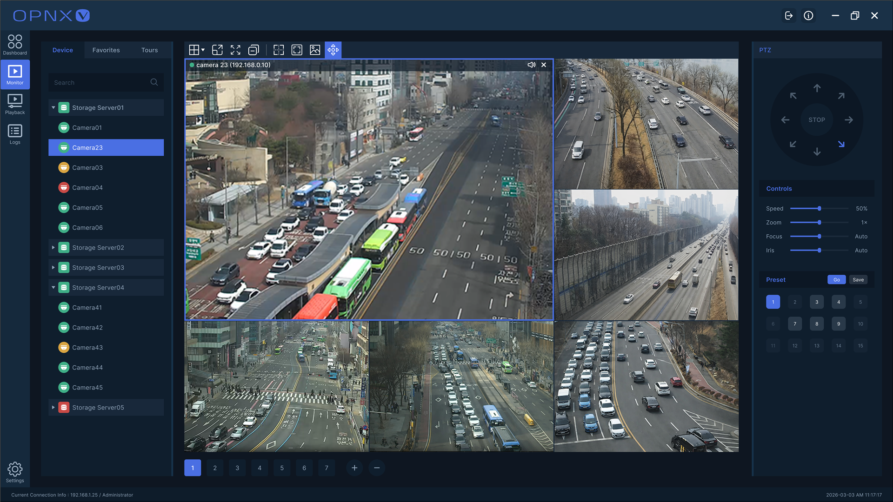
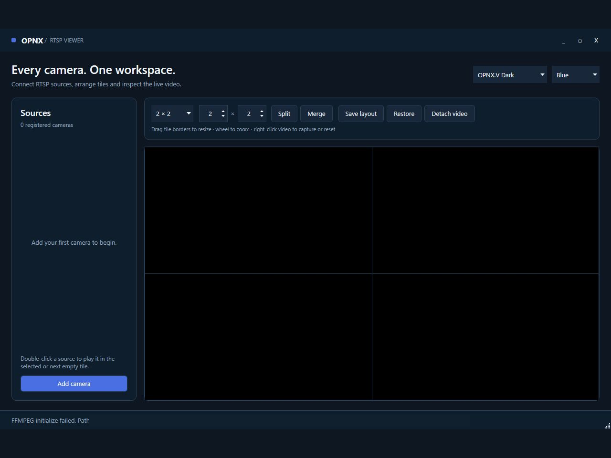
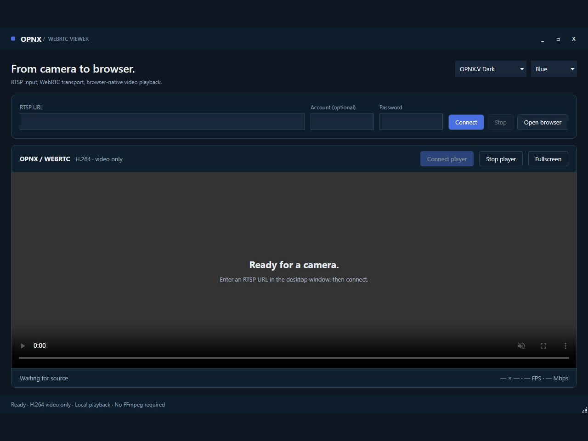
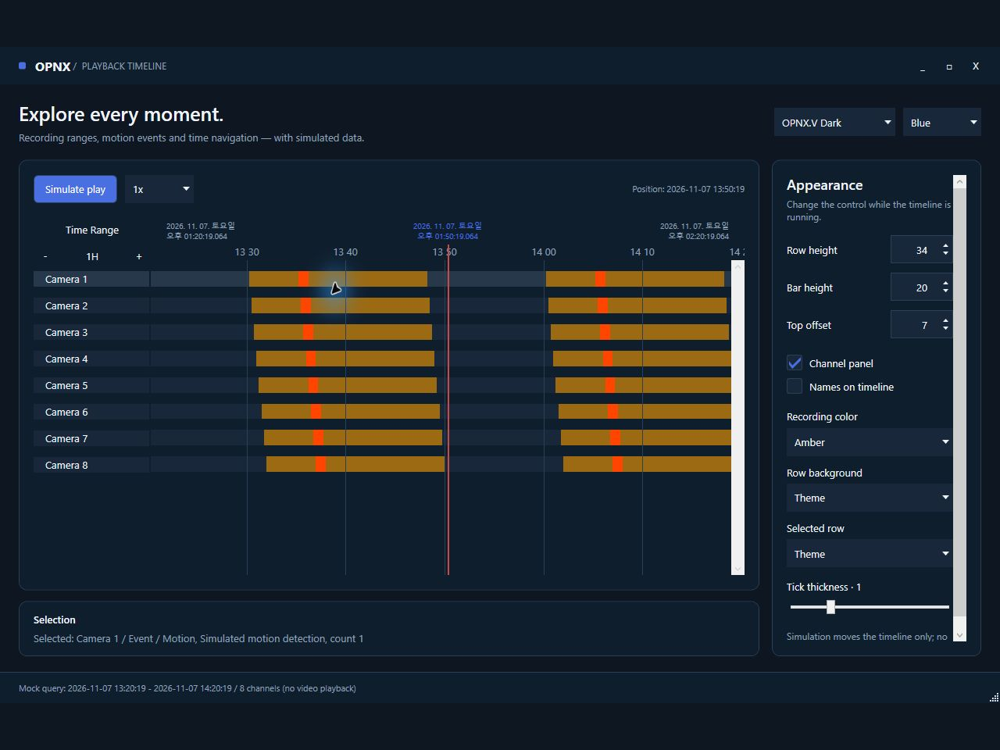
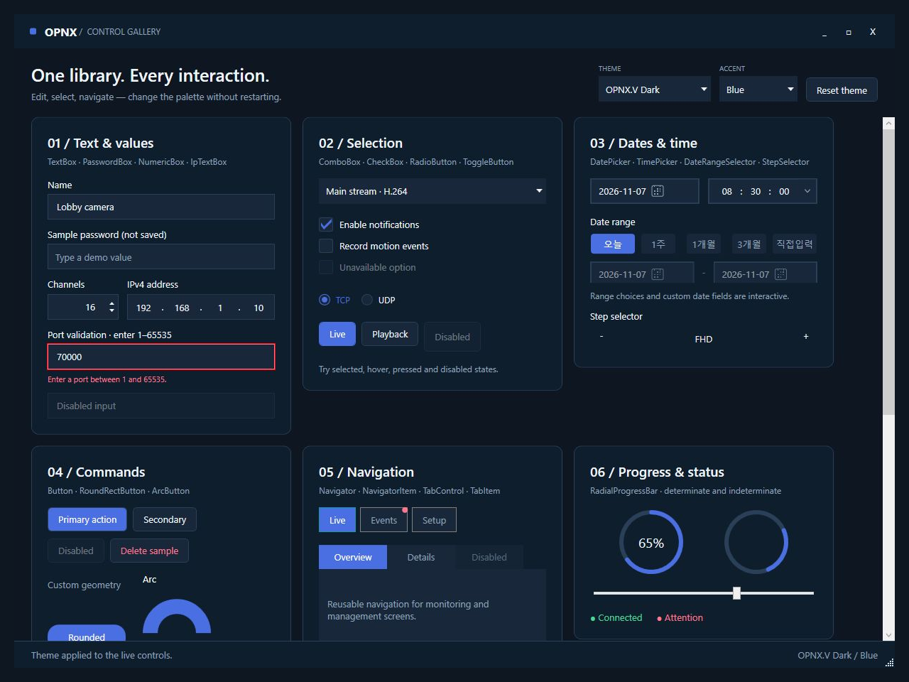
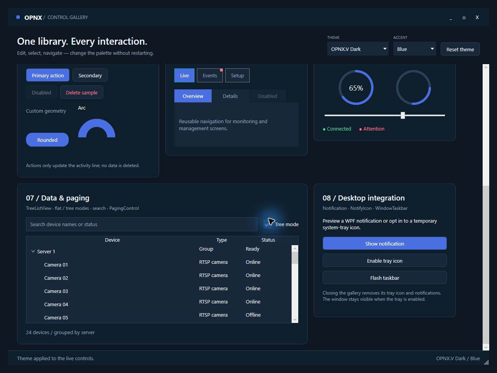
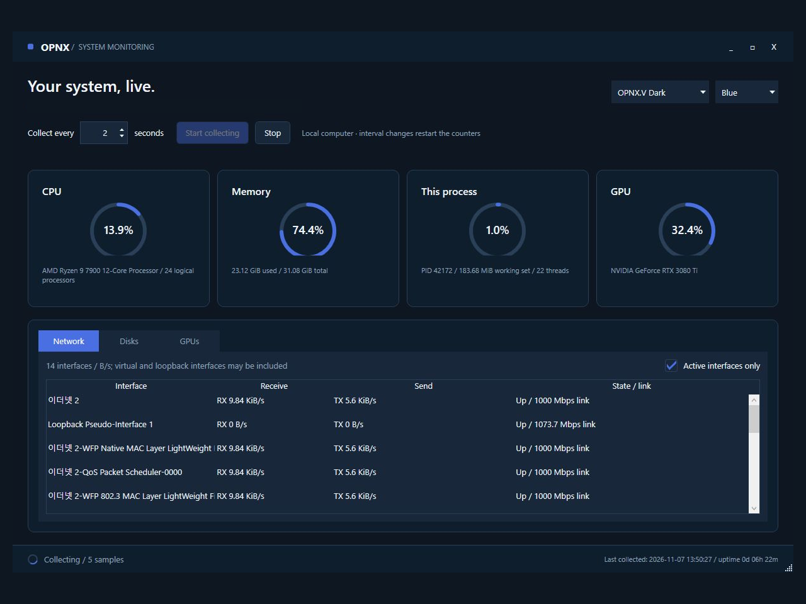

# OPNX 샘플

[English](README.md)

**OPNX.Lib와 OPNX.UI를 직접 평가할 수 있는 C# 실행 샘플입니다.**

RTSP MultiView · FFmpeg 디코딩 · WPF 영상 · 재생 타임라인 · TCP / Named Pipe / SharedMemory · EntityStore

[RTSP 뷰어 실행](#rtsp-viewer-실행) · [WebRTC 실행](#webrtc-viewer-실행) · [타임라인 실행](#playback-timeline-실행) · [OPNX.Lib](https://github.com/OPNXLabs/opnx-lib) · [OPNX.UI](https://github.com/OPNXLabs/opnx-ui) · [평가 및 OEM 문의](#상업-라이선스-및-oem-문의)


## 시작할 샘플을 선택하세요

| 샘플 | 확인할 수 있는 기능 | 요구사항 |
| --- | --- | --- |
| [`RtspViewer`](#rtsp-viewer-실행) | RTSP 입력, FFmpeg 디코딩, WPF 영상 표시, 카메라 탐색 및 구성 가능한 MultiView | Windows, .NET 10, FFmpeg 네이티브 DLL, RTSP 소스 |
| [`WebRtcViewer`](#webrtc-viewer-실행) | RTSP → WebRTC → WebView2 / 브라우저 영상 재생과 수신 통계 | Windows, .NET 10, WebView2 Runtime, H.264 RTSP 소스 |
| [`PlaybackTimeline`](#playback-timeline-실행) | 다채널 녹화 구간, 이벤트, 시간 탐색, 선택 및 타임라인 스타일 | Windows 및 .NET 10 |
| [`ControlGallery`](#control-gallery-실행) | 기본·운영 컨트롤, 즉시 테마·강조색 전환, 트리/목록 검색·페이징 | Windows 및 .NET 10 |
| [`SystemMonitoring`](#system-monitoring-실행) | OPNX.UI 기반 로컬 CPU·메모리·프로세스·네트워크·디스크·GPU 모니터링 | Windows 및 .NET 10 |
| [`ProtocolChat`](#protocol-chat-실행) | TCP / Named Pipe / SharedMemory의 공통 채팅·요청응답·시간 초과·취소 | .NET 10, SharedMemory는 Windows 필요 |
| [`EntityStore`](#entitystore-실행) | 메모리 기반 엔티티 CRUD, 조회, 복사/업데이트 및 변경 알림 | .NET 10 |

> **라이선스:** OPNX Samples는 오픈 소스가 아닌 source-available 소프트웨어입니다. [LICENSE.txt](LICENSE.txt)에 따라 학습, 연구, 테스트 및 비상업적 평가에 사용할 수 있습니다. 상업적 사용, 운영 환경 사용, 재배포 및 OEM 통합에는 OPNX의 사전 서면 허가가 필요합니다. 샘플은 OPNX.Lib 또는 OPNX.UI에 대한 추가 권리를 부여하지 않습니다.
> 기업 내부의 비운영 평가·PoC·기술 검토도 허용됩니다. 상세 범위는 아래 평가 안내와 영문 라이선스를 확인하세요.

## 샘플에서 VMS/NVR까지

샘플은 SDK와 UI의 개별 기능을 분리해 보여줍니다. OPNX.V는 같은 기반을 라이브 모니터링, 스케줄 녹화, 저장영상 검색, 동기 재생, 장치 관리, 권한, 로그, 이벤트 및 알람을 포함하는 개발 중인 VMS/NVR 애플리케이션으로 구성합니다.



## 샘플

- `OPNX.Samples.RtspViewer`: OPNX.Lib와 OPNX.UI.WPF를 사용하는 WPF RTSP 멀티 라이브 뷰어 샘플입니다.
- `OPNX.Samples.WebRtcViewer`: RTSP H.264 영상을 WebRTC로 중계해 WebView2와 외부 브라우저에서 재생하는 WPF 샘플입니다.
- `OPNX.Samples.PlaybackTimeline`: OPNX.Lib 데이터 모델과 OPNX.UI.WPF 타임라인 컨트롤을 사용하는 WPF 재생 타임라인 샘플입니다.
- `OPNX.Samples.ControlGallery`: 기본·운영 컨트롤과 즉시 테마 전환, 검색 가능한 트리/목록·페이징·알림·선택적 트레이 기능을 제공하는 WPF 갤러리입니다.
- `OPNX.Samples.SystemMonitoring`: OPNX.UI 실시간 게이지·테마·탭·자원 목록을 사용하는 로컬 시스템 모니터링 샘플입니다.
- `OPNX.Samples.ProtocolChat`: OPNX.Lib의 TCP, Named Pipe, SharedMemory에서 패킷과 메시지 처리를 공유하는 콘솔 채팅 샘플입니다.
- `OPNX.Samples.EntityStore`: OPNX.Lib의 메모리 기반 엔티티 CRUD, 조회, 복사/업데이트, 변경 이벤트를 사용하는 콘솔 EntityStore 샘플입니다.

## UI 구성과 조작 흐름

다섯 WPF 샘플은 같은 제목 표시줄, 카드·패널, 상태줄과 OPNX.UI 입력·명령 컨트롤을 사용합니다. 오른쪽 위에서 **OPNX.V Dark / Graphite / Light** 테마와 **Blue / Teal / Amber** 강조색을 즉시 전환합니다. `src/Shared/Themes/SampleTheme.cs`와 `Controls.xaml`을 링크하며 OPNX.V 프로젝트를 참조하지 않습니다. 화면의 버튼 이름은 실제 UI와 맞춰 영문으로 표기했습니다.

| 화면 | 배치와 역할 | 먼저 해볼 동작 |
| --- | --- | --- |
| **RtspViewer** | 왼쪽 카메라 목록과 `Add camera`, 위쪽 배치 도구, 중앙 MultiView, 아래 상태줄. 카메라 등록 창과 영상 헤더도 공통 테마 적용 | 카메라 등록 → 목록 더블클릭 → 분할·병합 → 휠 줌·우클릭 캡처. `Save layout`/`Restore`는 현재 실행 세션 안에서만 유지 |
| **WebRtcViewer** | 위쪽 RTSP URL·계정·비밀번호와 `Connect`/`Stop`/`Open browser`, 아래 WebView2 영상·상태·해상도·FPS·수신량 | H.264 소스 연결 → 브라우저 재생 → 외부 브라우저에서도 같은 플레이어 열기. `Stop`은 소스 전체, `Stop player`는 해당 플레이어만 중지 |
| **PlaybackTimeline** | 위쪽 모의 재생·배속, 중앙 채널별 녹화·이벤트, 아래 선택 정보, 오른쪽 Appearance 패널 | 이벤트 선택 → 시간 범위 이동 → `Simulate play` → 행·막대 높이와 색상 변경. 실제 영상 재생이 아닌 모의 데이터 UI |
| **ControlGallery** | 입력·선택·날짜/시간·버튼·탐색·진행률·트리/목록·데스크톱 통합을 한 화면의 카드로 구성 | Port 검증 → `Tree mode` 전환 → 검색·페이징 → 알림. 트레이 아이콘은 선택적으로 활성화 |
| **SystemMonitoring** | 수집 제어와 갱신 시각, CPU·메모리·현재 프로세스·GPU 요약, 네트워크·디스크·GPU 상세 탭 | 1–60초 주기 변경 → 중지·재시작 → 인터페이스 필터. 디스크는 용량이며 누락된 GPU 값은 `N/A` |

영상 영역은 검정 배경을 유지합니다. WebRtcViewer의 HTML 플레이어는 WPF 내부에서 테마·강조색 메시지를 받으며 외부 브라우저에서는 기본 다크 테마로 표시됩니다. OPNX.UI는 WPF 화면에 사용하고, 실제 WebRTC 영상 재생은 브라우저의 `<video>`가 담당합니다.

아래 실행 안내에 현재 Release 빌드의 실제 화면을 첨부했습니다. OPNX.V Dark / Blue 테마와 공통 이미지 크기를 사용하며 PC 이름과 로컬 경로는 가렸습니다. 캡처 상태는 [이미지 안내](docs/images/README.md)를 참고하세요.

## 사용한 OPNX 컴포넌트

이 샘플들은 OPNX.Lib와 OPNX.UI만으로 작은 애플리케이션을 구성하는 방법을 보여주기 위한 예제입니다.

OPNX.V 서버, 저장소, 사용자, 권한, 장치 관리, 녹화 모델에는 의존하지 않습니다.

`OPNX.Samples.RtspViewer`는 아래 컴포넌트 사용 흐름을 보여줍니다.

- `OPNX.Lib.Streaming.RTSP`: RTSP 연결, 스트림 구성, NAL unit 전달.
- `OPNX.Lib.Media.FFMpeg`: FFmpeg 초기화와 디코딩된 영상 프레임 처리.
- `OPNX.UI.WPF.Controls.OpnxMultiView`: 라이브뷰 타일 레이아웃, 선택 셀 배치, 셀 분할과 병합.
- `OPNX.UI.WPF.Controls.OpnxTreeListView`: 카메라 목록 표시.

- `OPNX.UI.WPF.Controls.OpnxTitlebar`: borderless WPF 창의 커스텀 타이틀바.
- `OPNX.UI.WPF.Controls.OpnxButton`, `OpnxTextBox`, `OpnxPasswordBox`, `OpnxComboBox`, `OpnxNumericBox`: OPNX UI 리소스로 스타일링된 입력 및 명령 컨트롤.

`OPNX.Samples.ProtocolChat`는 하나의 `ChatPeer` 메시지 처리기와 콘솔 입력 루프로 세 전송 방식을 보여줍니다.

| 전송 방식 | SDK 컴포넌트 | 연결 구성 |
| --- | --- | --- |
| TCP | `OPNXTcpServer`, `OPNXTcpClient` | IP 주소와 포트, 실행당 클라이언트 한 개 수락 |
| Named Pipe | `OPNXNPipeServer`, `OPNXNPipeClient` | 서로 일치하는 로컬 Pipe 이름 |
| SharedMemory | `OPNXSMProducer`, `OPNXSMConsumer` | 단방향 이름 채널 두 개를 서버·클라이언트에서 반대로 연결 |

TCP와 Named Pipe 클라이언트는 `OPNXClientBase`를 공유합니다. Named Pipe 서버와 SharedMemory도 같은 패킷 이벤트·송신 형태를 제공하지만 모두 하나의 SDK 인터페이스를 구현하는 구조는 아닙니다. 샘플은 송신 연산을 Delegate로 `ChatPeer`에 전달하며 별도 Transport 인터페이스는 만들지 않습니다. 연결 구성과 수명주기만 다르고 `PacketHeader`, Payload Type, 직렬화, 문자 처리, 요청 ID, 응답 대기, 시간 초과와 취소는 공통으로 처리합니다.

이 SDK의 SharedMemory는 Windows 이름 기반 Memory Map을 사용하며 Socket 형태의 연결·해제 이벤트가 없습니다. 공통 준비 메시지를 교환해 상대 샘플 프로세스가 실행 중인 것을 확인한 뒤 입력을 시작합니다. 시작 대기는 최대 30초, 요청 시간 초과는 3초입니다. 이름마다 서버·클라이언트 한 쌍만 실행하고 세션을 다시 시작할 때는 양쪽을 재실행합니다. TCP는 다른 장비와 연결할 수 있으며 샘플의 Named Pipe·SharedMemory는 로컬 IPC입니다. Named Pipe는 서버부터 시작하고 SharedMemory는 어느 쪽부터 시작해도 됩니다.

`OPNX.Samples.EntityStore`는 아래 컴포넌트 사용 흐름을 보여줍니다.

- `OPNX.Lib.Data.ORM.Entity`: 작은 샘플 엔티티 정의.
- `OPNX.Lib.Data.ORM.Datas.Attributes.EntityColumnAttribute`: ORM 스타일 매핑을 위한 엔티티 필드 설명.
- `OPNX.Lib.Data.ORM.EntityStore`: 메모리 기반 insert, update, delete, lookup, collection access.
- `EntityChanged` 이벤트를 이용한 insert, update, delete, property-change 알림.

`EntityStore`는 EF Core를 대체하기 위한 범용 ORM이라기보다 OPNX 지향 엔티티 저장 패턴입니다.

OPNX 애플리케이션에서 상태 엔티티를 메모리에 유지하고 변경 이벤트를 발생시키는 용도에 초점을 둡니다.

또한 속성 기반 필드 메타데이터를 제공하고 MySQL/PostgreSQL 같은 DB 서비스와 선택적으로 동기화할 수 있습니다.

이 샘플은 외부 DB 준비 없이 실행할 수 있도록 DB 설정을 기본 흐름에서 제외했습니다.

`OPNX.Samples.PlaybackTimeline`은 아래 컴포넌트 사용 흐름을 보여줍니다.

- `OPNX.UI.WPF.Controls.OpnxPlaybackTimeline`: 재생 범위, 현재 시각, 선택 및 타임라인 시각화.
- OPNX.Lib 기반 녹화·이벤트 모델과 재생 UI 컨트롤의 바인딩.
- 타임라인 레이아웃, 스타일, 확대 범위 선택 및 녹화 미디어 리뷰 상호작용.


## 업데이트된 샘플 조작 방법

- **RTSP 뷰어:** 타일 경계선을 드래그해 크기를 조절합니다. 영상 위 마우스 휠로 디지털 줌을 조절하고 우클릭 메뉴에서 줌 초기화 또는 표시 중인 프레임의 PNG 저장을 실행합니다. `Save layout`은 현재 실행 세션의 배치를 저장하며 `Restore layout`은 가능한 연결을 유지하고 저장한 배치의 수용량을 넘는 영상을 종료합니다. `Detach video`는 선택한 영상을 재연결 없이 별도 창으로 옮깁니다. 별도 창을 닫으면 빈 타일로 복귀하고, 빈 타일이 없으면 영상을 종료합니다. 기본 Layout 변경·분할·병합은 영향을 받는 영상을 종료한 뒤 적용합니다. 카메라 자격 증명은 디스크에 저장하지 않습니다.
- **Timeline:** 모의 채널 8개의 녹화 구간·빈 구간·Motion 이벤트를 표시합니다. 채널·녹화 막대·이벤트를 클릭하면 선택 정보를 확인할 수 있으며 시간 이동이나 범위 변경 시 해당 범위의 모의 데이터를 조회합니다. `Simulate play`와 0.25x–8x 배속은 타임라인 위치만 이동하며 미디어 파일이나 영상 재생기는 연결하지 않습니다.
- **EntityStore:** 콘솔에서 CRUD, 불변 Row Change, 직접 속성 변경 알림과 추적 객체의 동일성을 확인합니다. 데이터베이스는 필요하지 않습니다.
- **Protocol 채팅:** 일반 문자는 Notice Packet으로 전송합니다. `/request <문자열>`은 ID로 연결한 Echo 요청·응답, `/timeout`은 의도적으로 응답하지 않는 요청의 3초 시간 초과, `/cancel`은 같은 요청의 250ms 후 취소를 보여줍니다. Ctrl+C로 종료합니다. 요청 ID와 응답 대기 로직은 SDK Packet Type 위에 샘플이 구현합니다.

## 빌드

Windows의 .NET 10 SDK와 ASP.NET Core 10 공유 프레임워크를 준비합니다. 전체 솔루션에는 WPF 프로젝트가 포함됩니다. FFmpeg 네이티브 DLL은 RtspViewer 실행 시, WebView2 Runtime은 WebRtcViewer 실행 시에만 필요합니다.

```powershell
dotnet build .\OPNX.Samples.slnx -c Debug
```

## RTSP Viewer 실행



MultiView 배치와 소스 패널입니다. 캡처 환경에 FFmpeg 네이티브 DLL이 없어 초기화 오류가 표시되며 실제 영상은 재생하지 않습니다.

```powershell
dotnet run --project src/OPNX.Samples.RtspViewer
```

## WebRTC Viewer 실행



연결 전 입력·브라우저 플레이어 화면입니다. 카메라 주소와 계정 정보는 비어 있습니다.

```powershell
dotnet run --project src/OPNX.Samples.WebRtcViewer
```

Windows, .NET 10, Microsoft Edge WebView2 Runtime이 필요합니다. `rtsp://` 주소와 필요한 경우 계정·비밀번호를 입력한 뒤 **Connect**를 누릅니다. **Stop**은 RTSP 소스와 모든 플레이어 연결을 종료합니다. **Open browser**로 기본 브라우저에서도 같은 플레이어를 열 수 있습니다(Chrome/Edge 권장). 데스크톱 앱은 실행 중이어야 합니다.

OPNX.Lib의 RTSP-over-TCP 수신과 WebRTC H.264 송출을 연결하고, WebView2 안의 HTML `<video>`로 재생합니다. FFmpeg DLL은 필요하지 않습니다. 브라우저와 협상한 프로파일에 맞는 H.264 카메라 스트림을 선택하세요. H.265 변환과 오디오 전달은 포함하지 않습니다. 플레이어에는 수신 해상도·FPS·비트레이트가 표시됩니다. 새 플레이어는 다음 키프레임부터 재생하며 로컬 플레이어는 최대 4개까지 연결할 수 있습니다.

중계 서버는 자동 선택한 포트의 `127.0.0.1`에만 바인딩하고 실행마다 새로운 플레이어 경로를 사용합니다. 카메라 계정 정보는 데스크톱 프로세스 메모리에만 보관하며 브라우저 URL이나 설정 파일에 저장하지 않습니다. 원격 접속·TURN·운영용 인증은 이 샘플의 범위에 포함하지 않습니다. 앱을 종료하면 서버와 스트림도 종료됩니다. 네이티브 DataChannelDotnet 의존성은 OPNX.Lib가 제공하며 Windows x64 실행을 권장합니다.

## Playback Timeline 실행



모의 녹화 구간·Motion 이벤트·선택 정보와 Appearance 패널입니다.

```powershell
dotnet run --project src/OPNX.Samples.PlaybackTimeline
```

## Control Gallery 실행



입력·검증·선택·날짜/시간·버튼·탐색·진행률 컨트롤입니다.



계층형 트리·검색·데스크톱 통합 영역입니다.

```powershell
dotnet run --project src/OPNX.Samples.ControlGallery
```

한 창에서 입력·선택·날짜/시간·버튼·탐색·진행률·데이터·데스크톱 통합 컨트롤을 조작합니다. `Theme`에서 OPNX.V Dark / Graphite / Light, `Accent`에서 Blue / Teal / Amber를 선택하면 기존 컨트롤에 즉시 반영되며 `Reset theme`으로 기본값을 복원합니다. OPNX.V의 공통 Brush·컨트롤 Style 리소스 구성 방식을 따른 독립 샘플 팔레트이며 OPNX.V 프로젝트를 참조하지 않습니다.

데이터 영역은 검색·페이징을 지원하는 일반 목록과 서버별 계층 트리를 제공하며 `Tree mode`로 전환합니다. 유효한 Port를 입력하면 오류 표시가 해제됩니다. 알림에도 현재 테마가 적용됩니다. 트레이 아이콘은 버튼으로 활성화하고 창은 계속 표시하며 종료 시 제거합니다. 현재 패키지에서 고정 색상을 쓰는 DateRangeSelector 내부는 시각 자식 생성 후 샘플 스타일을 적용합니다. 영상 컨트롤은 기존 뷰어·타임라인 샘플에서 다루며, 이 갤러리는 FFmpeg 설정 없이 실행할 수 있습니다.

## System Monitoring 실행



실제 로컬 시스템 수집 화면입니다. PC 이름은 가렸습니다.

```powershell
dotnet run --project src/OPNX.Samples.SystemMonitoring
```

기본 2초 주기로 자동 수집합니다. `Stop`은 마지막 정상 Snapshot과 갱신 시각을 유지하며 `Start collecting`은 새 수집기로 다시 시작합니다. 주기는 1–60초로 설정하고 수집 중 변경하면 Monitor를 다시 시작합니다. CPU·현재 프로세스 사용률과 네트워크 속도는 계산 기준 표본이 준비될 때까지 Sampling 상태를 표시합니다. 새로 나타난 네트워크 인터페이스도 별도 기준 표본이 필요합니다.

화면은 OPNX.UI의 `OpnxTitlebar`, `OpnxComboBox`, `OpnxNumericBox`, `OpnxButton`, `OpnxRadialProgressBar`, `OpnxTabControl`·`OpnxTabItem`, `OpnxCheckBox`, `OpnxTreeListView`로 구성합니다. 네트워크·디스크 Volume 용량·GPU 상세를 탭으로 나눕니다. 네트워크 속도 단위는 B/s이며 가상·필터·Loopback 인터페이스가 포함될 수 있으므로 중복될 수 있는 전체 합계는 만들지 않습니다. `Active interfaces only`는 동작 상태가 Up인 인터페이스만 표시합니다. 프로세스 카드는 전체 프로세스 목록이 아니라 현재 샘플 프로세스의 상태입니다.

GPU의 누락된 nullable 값은 `N/A`로 표시하며 미지원 또는 수집 불가를 의미합니다. SDK가 모든 누락 원인을 구분하지는 않습니다. GPU 목록이 비어 있어도 하드웨어가 없다고 단정하지 않습니다. 전체 수집 오류는 마지막 정상 값을 유지하고 오류 메시지를 표시합니다. GPU 지원 범위는 운영체제·Driver에 따라 다르며 이 WPF 샘플은 Windows에서 실행합니다. 디스크 사용률은 저장 용량이며 I/O 속도가 아닙니다. 시스템 설정 변경·원격 조회는 수행하지 않고 FFmpeg 바이너리는 필요하지 않습니다.

갤러리·모니터링·RTSP 뷰어·타임라인·WebRTC 뷰어 앱은 `src/Shared/Themes/SampleTheme.cs`와 `Controls.xaml`을 링크해 공유합니다. 테마·강조색은 수집을 재시작하지 않고 기존 컨트롤에 즉시 반영합니다. 비공개 OPNX.V 프로젝트는 참조하지 않습니다. WebRtcViewer는 브라우저 재생을 위해 Microsoft WebView2를 추가로 사용합니다.

## Protocol Chat 실행

저장소 디렉터리에서 터미널 두 개를 엽니다. 전송 방식 하나를 선택하고 첫 터미널에서 해당 서버 명령, 두 번째 터미널에서 클라이언트 명령을 실행합니다.

```powershell
# TCP (기본값: 127.0.0.1:9000)
dotnet run --project src/OPNX.Samples.ProtocolChat -- tcp server
dotnet run --project src/OPNX.Samples.ProtocolChat -- tcp client

# 로컬 Named Pipe (기본 이름: opnx-protocol-chat)
dotnet run --project src/OPNX.Samples.ProtocolChat -- pipe server
dotnet run --project src/OPNX.Samples.ProtocolChat -- pipe client

# 로컬 SharedMemory (Windows 전용, 기본 이름: opnx-protocol-chat)
dotnet run --project src/OPNX.Samples.ProtocolChat -- shm server
dotnet run --project src/OPNX.Samples.ProtocolChat -- shm client
```

공통 준비 메시지 교환이 끝나면 양쪽에 `peer ready`가 표시됩니다. 문자를 입력하면 상대에게 전송합니다. `/request hello`는 Echo 응답, `/timeout`은 의도적으로 응답하지 않는 요청, `/cancel`은 취소를 보여주며 `exit` 또는 Ctrl+C로 종료합니다.

선택 인수는 `tcp server|client [IP] [port]`, `pipe server|client [pipe-name]`, `shm server|client [channel-name]`입니다. 양쪽 전송 방식과 Endpoint가 일치해야 합니다. 전송 방식을 생략한 `server`·`client`는 TCP의 축약형으로 유지하지만 프로젝트 경로는 `OPNX.Samples.ProtocolChat`으로 변경됐습니다.

## EntityStore 실행

```powershell
dotnet run --project src/OPNX.Samples.EntityStore
```

## 공통 UI 구성

다섯 WPF 샘플은 `src/Shared/Themes`의 공통 Brush 팔레트와 컨트롤 Style을 공유하며 오른쪽 위에서 테마와 강조색을 전환합니다. RTSP 뷰어는 소스 패널·배치 도구·고정 상태줄을 사용하고 등록 창과 영상 헤더에도 같은 팔레트를 적용합니다. 영상 Surface는 검정 배경을 유지합니다. Timeline은 재생·선택 결과를 중심 작업 공간에 두고 크기·표시·색상 설정을 오른쪽 패널에 배치합니다. 테마 변경 시 타임라인 데이터·선택·재생 상태는 유지합니다. 녹화 색상도 라이트·다크 모드에 맞춰 대비를 조절하며 현재 패키지의 고정된 Timeline 헤더 글자색은 샘플에서 보완합니다.

## FFmpeg 네이티브 바이너리

FFmpeg를 사용하는 샘플은 실행 시 호환되는 FFmpeg 네이티브 DLL이 필요합니다. 관리 코드 패키지인 `FFmpeg.AutoGen`에는 FFmpeg 네이티브 바이너리가 포함되어 있지 않습니다.

애플리케이션 실행 경로 기준으로 FFmpeg를 초기화하는 샘플은 아래 위치에 네이티브 DLL을 배치합니다.

```text
FFMpeg/Lib/x64
FFMpeg/Lib/x86
```

64비트 Debug 실행 기준의 실무적인 준비 순서는 다음과 같습니다.

1. 먼저 솔루션을 한 번 빌드해서 출력 폴더를 생성합니다.
2. 프로세스 아키텍처와 맞는 FFmpeg shared-library DLL을 준비합니다.
3. 빌드 출력 폴더 아래에 `FFMpeg/Lib/x64` 디렉터리를 만듭니다.
4. 준비한 FFmpeg DLL을 해당 디렉터리에 복사합니다.
5. 샘플을 다시 실행합니다.

예를 들어 64비트 Debug 출력 폴더에는 아래와 비슷한 파일들이 있어야 합니다.

```text
src/OPNX.Samples.RtspViewer/bin/Debug/net10.0-windows/FFMpeg/Lib/x64/avcodec-*.dll
src/OPNX.Samples.RtspViewer/bin/Debug/net10.0-windows/FFMpeg/Lib/x64/avformat-*.dll
src/OPNX.Samples.RtspViewer/bin/Debug/net10.0-windows/FFMpeg/Lib/x64/avutil-*.dll
src/OPNX.Samples.RtspViewer/bin/Debug/net10.0-windows/FFMpeg/Lib/x64/avfilter-*.dll
src/OPNX.Samples.RtspViewer/bin/Debug/net10.0-windows/FFMpeg/Lib/x64/avdevice-*.dll
src/OPNX.Samples.RtspViewer/bin/Debug/net10.0-windows/FFMpeg/Lib/x64/swscale-*.dll
src/OPNX.Samples.RtspViewer/bin/Debug/net10.0-windows/FFMpeg/Lib/x64/swresample-*.dll
```

샘플 화면에 `FFMPEG initialize failed`가 표시된다면, 상태 메시지에 표시된 경로에 DLL 파일이 있는지 먼저 확인합니다.

또한 DLL 아키텍처가 실행 프로세스와 맞는지도 확인합니다.

이 샘플 저장소에는 FFmpeg 바이너리를 커밋하지 않습니다.

자체 빌드와 함께 FFmpeg 바이너리를 재배포한다면, 선택한 FFmpeg 빌드가 사용 목적에 맞게 재배포 가능한지 확인해야 합니다.

또한 해당 FFmpeg 라이선스 조건을 준수해야 합니다.

일반적으로 애플리케이션이 GPL 또는 nonfree 요구사항을 충족할 준비가 되어 있지 않다면, 동적 링크 방식의 LGPL 빌드를 사용하고 GPL/nonfree 구성 요소가 포함되지 않은 빌드를 선택하는 편이 좋습니다.

참고:

- https://ffmpeg.org/legal.html
- https://ffmpeg.org/download.html

## 패키지 의존성

모든 샘플은 로컬 OPNX 소스 프로젝트가 아니라 공개된 NuGet 패키지를 사용합니다.

- `OPNX.Lib`: `0.1.0-preview.20261106.3`
- `OPNX.UI.WPF`: `0.1.0-preview.20261107.1`

- `Microsoft.Web.WebView2`: `1.0.4258.31` — WebRtcViewer 전용이며 WebView2 Runtime은 별도로 필요합니다.

OPNX 패키지 버전은 [Directory.Build.props](Directory.Build.props)에서 중앙 관리하고 WebView2 SDK 버전은 WebRtcViewer 프로젝트에 지정합니다.

## 평가와 코드 활용 범위

- 개인 학습, 연구, 테스트와 비상업적 평가에 사용할 수 있습니다.
- 기업 내부의 비운영 평가, PoC와 기술 검토도 라이선스에 따라 별도 서면 허가 없이 가능합니다.
- 실제 운영, 고객 대상 서비스, 상용 제품·OEM 통합과 재배포에는 사전 서면 허가가 필요합니다.
- 평가용 코드 수정 권한이 상용 제품에 코드를 포함하거나 수정본을 재배포할 권한까지 부여하지는 않습니다.
- OPNX 소유 코드와 의존성의 라이선스는 각각 적용됩니다. 최종 조건은 저장소의 영문 라이선스를 확인하세요.

## 최신 SDK와 샘플 버전

이 저장소는 위에 명시된 공개 패키지 버전으로 실행하는 일곱 개의 샘플을 제공합니다. 최신 Lib·UI 소스의 모든 기능을 포함하지 않습니다.

| 현재 SDK 소스의 기능 | 이 샘플 저장소 |
| --- | --- |
| RTSP 입력·디코딩·MultiView | `RtspViewer` |
| 다채널 재생 타임라인 | `PlaybackTimeline` |
| TCP / Named Pipe / SharedMemory 메시지 송수신 | `ProtocolChat` |
| 메모리 EntityStore CRUD | 고정 패키지 API를 사용하는 `EntityStore` |
| WebRTC 미디어 송출·Kestrel 시그널링 | `WebRtcViewer`: H.264 영상과 로컬 브라우저 시그널링 |
| TCP 파일 전송·SharedMemory 원본 버퍼 | 전용 실행 샘플 없음 |
| 알림·트레이·날짜 및 시간 입력 | `ControlGallery` |
| Remux·자막 | 전용 실행 샘플 없음 |

EntityStore 샘플은 `EntityColumn`, 명시적인 엔티티·키 타입과 `FindCurrent<TEntity, TKey>`를 사용합니다. 변경 속성과 변경 전후 값, 직접 속성 변경 알림을 출력하며 업데이트 후에도 추적 객체가 유지되는 것을 보여줍니다. 메모리 삽입에는 ID를 명시합니다. 직접 속성 변경 알림에는 이전 값이 없을 수 있으며 출력에서 확인 불가로 표시합니다.

선택한 패키지는 `FFmpeg.AutoGen 9.0.1.1`을 사용하므로 프로세스 아키텍처와 ABI가 맞는 FFmpeg 네이티브 라이브러리를 준비합니다. 통합 Lib 패키지는 ASP.NET Core 10 공유 프레임워크를 요구하며 DataChannelDotnet 네이티브 자산도 가져옵니다. 개별 샘플이 WebRTC를 실행하지 않더라도 해당 의존성은 적용됩니다.

## 라이선스

OPNX Samples는 source-available 형태로 공개되지만 permissive open-source software로 라이선스되는 것은 아닙니다.

OPNX 소유 샘플 코드는 학습, 평가, 연구, 테스트 및 기타 비상업적 목적으로 사용할 수 있습니다. 상업적 사용, 재배포, OEM 통합, 상업 제품 또는 서비스에의 포함에는 OPNX의 사전 서면 허가가 필요합니다.

샘플 공개는 OPNX.Lib, OPNX.UI, FFmpeg 또는 다른 의존성의 상업적 사용이나 재배포 권한을 부여하지 않습니다. 각 컴포넌트에는 해당 컴포넌트의 라이선스가 적용됩니다.

자세한 조건은 [LICENSE.txt](LICENSE.txt)를 확인하십시오. 한국어 참고 번역은 [LICENSE.ko.txt](LICENSE.ko.txt)에서 확인할 수 있습니다. 의존성 고지는 [THIRD-PARTY-NOTICES.md](THIRD-PARTY-NOTICES.md)를 확인하십시오.

## 관련 프로젝트

- [OPNX.Lib](https://github.com/OPNXLabs/opnx-lib)
- [OPNX.UI](https://github.com/OPNXLabs/opnx-ui)

## 상업 라이선스 및 OEM 문의

OPNX Samples는 대한민국에 사업자로 등록된 오픈엑스(OPNX)가 개발하고 배포합니다.

- [https://www.opnx.kr/](https://www.opnx.kr/)
- `opnx@opnx.kr`

## 보안 및 기여

- 보안 문제는 [SECURITY.ko.md](https://github.com/OPNXLabs/opnx-samples/blob/master/SECURITY.ko.md)의 절차에 따라 비공개로 제보해 주세요.
- 이슈 등록이나 변경 제안 전 [CONTRIBUTING.ko.md](https://github.com/OPNXLabs/opnx-samples/blob/master/CONTRIBUTING.ko.md)를 확인해 주세요.
