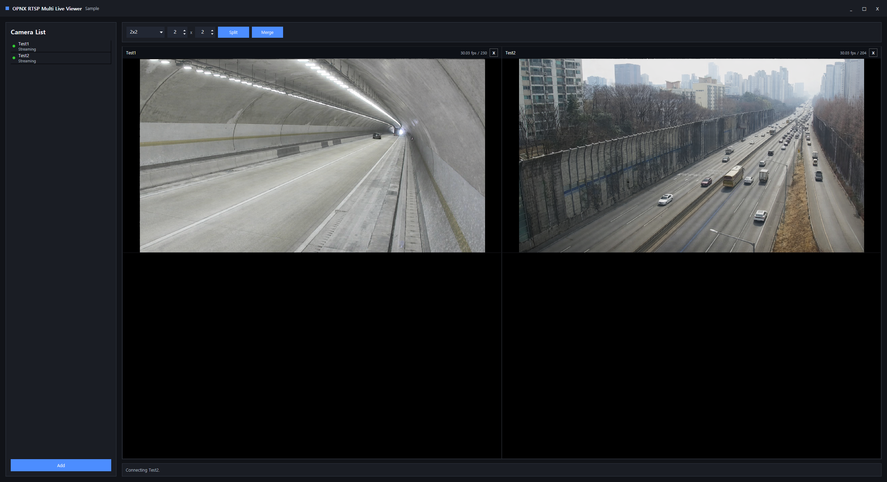
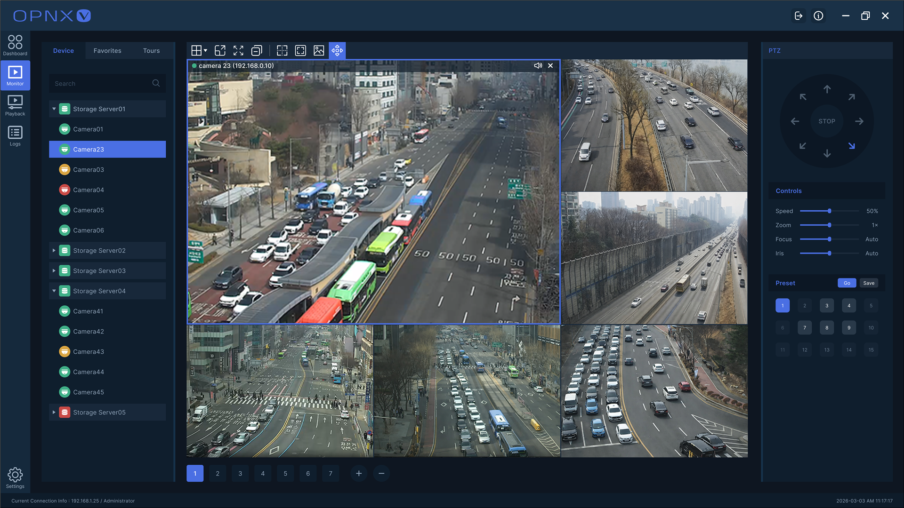
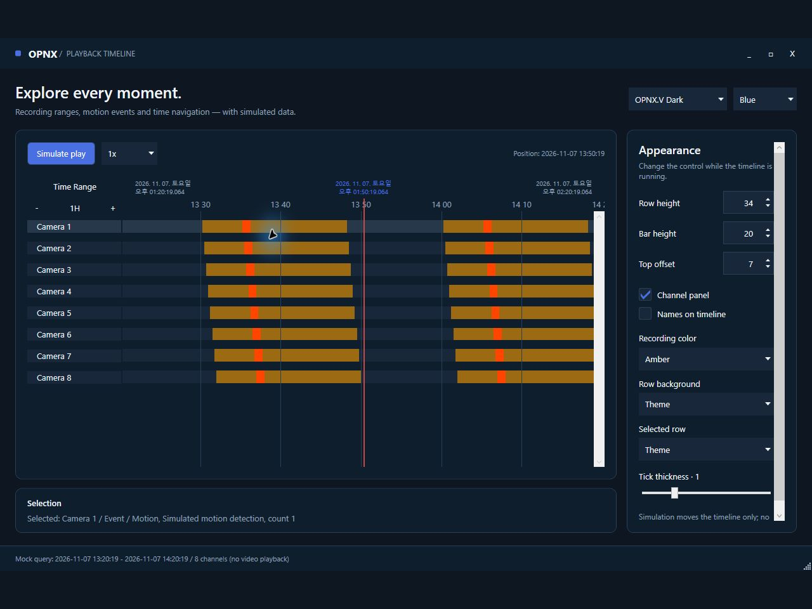

# OPNX Samples

[Korean](README.ko.md)

**Runnable C# samples for evaluating OPNX.Lib and OPNX.UI.**

RTSP multi-view · FFmpeg decoding · WPF video · Playback timeline · TCP · EntityStore

[Run the RTSP viewer](#run-rtsp-multi-live-viewer) · [Run the timeline](#run-playback-timeline) · [OPNX.Lib](https://github.com/OPNXLabs/opnx-lib) · [OPNX.UI](https://github.com/OPNXLabs/opnx-ui) · [Evaluation and OEM inquiries](#commercial-and-oem-inquiries)



## Choose A Starting Point

| Sample | What it demonstrates | Requirements |
| --- | --- | --- |
| [`RtspMultiLiveViewer`](#run-rtsp-multi-live-viewer) | RTSP input, FFmpeg decoding, WPF video presentation, camera navigation, and configurable MultiView | Windows, .NET 10, FFmpeg native DLLs, RTSP source |
| [`PlaybackTimeline`](#run-playback-timeline) | Multi-channel recording ranges, events, time navigation, selection, and timeline styling | Windows and .NET 10 |
| [`TcpChat`](#run-tcp-chat) | OPNX TCP client/server, packet framing, connection events, and text delivery | .NET 10 |
| [`EntityStore`](#run-entity-store) | In-memory entity CRUD, lookup, copy/update, and change notifications | .NET 10 |

> **License:** OPNX Samples is source-available, not open-source. Learning, research, testing, and non-commercial evaluation are permitted under [LICENSE.txt](LICENSE.txt). Commercial use, production use, redistribution, and OEM integration require prior written permission from OPNX. The samples do not grant additional rights to OPNX.Lib or OPNX.UI.

## From Samples To A VMS/NVR

The samples isolate individual SDK and UI capabilities. OPNX.V composes the same foundations into a VMS/NVR application under active development, including live monitoring, scheduled recording, recorded-video search, synchronized playback, device management, permissions, logs, events, and alarms.



## Samples

- `OPNX.Samples.RtspMultiLiveViewer`: A WPF RTSP multi-live viewer sample using OPNX.Lib and OPNX.UI.WPF.
- `OPNX.Samples.TcpChat`: A console TCP chat sample using OPNX.Lib TCP server, client, packet framing, and message delivery APIs.
- `OPNX.Samples.EntityStore`: A console EntityStore sample using OPNX.Lib in-memory entity CRUD, lookup, copy/update, and change events.
- `OPNX.Samples.PlaybackTimeline`: A WPF playback timeline sample using OPNX.Lib data models and OPNX.UI.WPF timeline controls.

## Used OPNX Components

The samples show how OPNX.Lib and OPNX.UI can be used together in small applications.

They do not depend on OPNX.V server, storage, user, permission, device-management, or recording models.

`OPNX.Samples.RtspMultiLiveViewer` demonstrates:

- `OPNX.Lib.Streaming.RTSP`: RTSP connection, stream configuration, and NAL unit delivery.
- `OPNX.Lib.Media.FFMpeg`: FFmpeg initialization and decoded video frame handling.
- `OPNX.UI.WPF.Controls.OpnxMultiView`: live-view tile layout, selected-cell placement, split, and merge.
- `OPNX.UI.WPF.Controls.OpnxTreeListView`: camera list presentation.

- `OPNX.UI.WPF.Controls.OpnxTitlebar`: custom borderless WPF window title bar.
- `OPNX.UI.WPF.Controls.OpnxButton`, `OpnxTextBox`, `OpnxPasswordBox`, `OpnxComboBox`, and `OpnxNumericBox`: common input and command controls styled with OPNX UI resources.

`OPNX.Samples.TcpChat` demonstrates:

- `OPNX.Lib.Network.Protocol.Tcp.OPNXTcpServer`: TCP server accept flow.
- `OPNX.Lib.Network.Protocol.Tcp.OPNXTcpClient`: TCP client connection wrapping and packet send/receive.
- `OPNX.Lib.Network.Protocol.Framing.PacketHeader`: OPNX packet header usage for framed text messages.
- `PacketReceived`, `Disconnected`, and `ClientAccepted` events for simple connection-oriented communication.

OPNX.Lib.Network is designed around common connection and packet concepts.

TCP, Named Pipe, and Shared Memory transports can share similar client/server-style usage patterns and the same packet framing model.

Application code can keep message definitions and packet handling consistent while choosing the transport that fits the deployment boundary.

This sample uses TCP because it is the easiest transport to run and understand.

The packet structure and event-driven communication style are intended to carry over to the other transports.

`OPNX.Samples.EntityStore` demonstrates:

- `OPNX.Lib.Data.ORM.Entity`: defining a small sample entity.
- `OPNX.Lib.Data.ORM.Datas.Attributes.DataColumnAttribute`: describing entity fields for ORM-style mapping.
- `OPNX.Lib.Data.ORM.EntityStore`: in-memory insert, update, delete, lookup, and collection access.
- `EntityChanged` events for insert, update, delete, and property-change notification.

`EntityStore` is not intended to be an EF Core replacement.

It provides an OPNX-oriented entity store pattern for keeping stateful entities in memory and raising entity change events.

It also describes fields with attributes and can optionally synchronize with database services such as MySQL or PostgreSQL.

This sample keeps database setup out of the default path so it can run without external infrastructure.

`OPNX.Samples.PlaybackTimeline` demonstrates:

- `OPNX.UI.WPF.Controls.OpnxPlaybackTimeline`: playback range, current time, selection, and timeline visualization.
- OPNX.Lib-backed record and event models bound to playback UI controls.
- Timeline layout, styling, zoom/range selection, and recorded-media review interaction.



## Build

```powershell
dotnet build .\OPNX.Samples.slnx -c Debug
```

## Run RTSP Multi Live Viewer

```powershell
dotnet run --project src/OPNX.Samples.RtspMultiLiveViewer
```

## Run TCP Chat

Start the server in one terminal:

```powershell
dotnet run --project src/OPNX.Samples.TcpChat -- server
```

Start the client in another terminal:

```powershell
dotnet run --project src/OPNX.Samples.TcpChat -- client
```

Both sides send text by typing a message and pressing Enter. Type `exit` to close either side.

## Run EntityStore

```powershell
dotnet run --project src/OPNX.Samples.EntityStore
```

## Run Playback Timeline

```powershell
dotnet run --project src/OPNX.Samples.PlaybackTimeline
```

## FFmpeg Native Binaries

Samples that use FFmpeg require compatible FFmpeg native DLLs at runtime. The managed `FFmpeg.AutoGen` package does not include FFmpeg native binaries.

For samples that initialize FFmpeg from the application directory, place the native DLLs under this application-relative path:

```text
FFMpeg/Lib/x64
FFMpeg/Lib/x86
```

A practical setup for a 64-bit Debug run is:

1. Build the solution once so the output directory is created.
2. Prepare FFmpeg shared-library DLLs that match the process architecture.
3. Create the `FFMpeg/Lib/x64` directory under the build output.
4. Copy the FFmpeg DLLs into that directory.
5. Run the sample again.

For example, the 64-bit Debug output should contain files similar to:

```text
bin/x64/Debug/net10.0-windows/FFMpeg/Lib/x64/avcodec-*.dll
bin/x64/Debug/net10.0-windows/FFMpeg/Lib/x64/avformat-*.dll
bin/x64/Debug/net10.0-windows/FFMpeg/Lib/x64/avutil-*.dll
bin/x64/Debug/net10.0-windows/FFMpeg/Lib/x64/avfilter-*.dll
bin/x64/Debug/net10.0-windows/FFMpeg/Lib/x64/avdevice-*.dll
bin/x64/Debug/net10.0-windows/FFMpeg/Lib/x64/swscale-*.dll
bin/x64/Debug/net10.0-windows/FFMpeg/Lib/x64/swresample-*.dll
```

If the sample shows `FFMPEG initialize failed`, first check the directory reported by the status message.

Also make sure the DLL architecture matches the process architecture.

FFmpeg binaries are not committed to this samples repository.

If you redistribute FFmpeg binaries with your own build, make sure the selected FFmpeg build is redistributable for your use case.

Also comply with the matching FFmpeg license terms.

In general, prefer an LGPL build that is dynamically linked and built without GPL or nonfree components unless your application is prepared to satisfy GPL/nonfree requirements.

Useful references:

- https://ffmpeg.org/legal.html
- https://ffmpeg.org/download.html

## Package Dependencies

All samples consume the published NuGet packages rather than local OPNX source projects.

- `OPNX.Lib`: `0.1.0-preview.20260716.1`
- `OPNX.UI.WPF`: `0.1.0-preview.20260716.1`

Package versions are managed centrally in [Directory.Build.props](Directory.Build.props).

## License

OPNX Samples is source-available, but it is not licensed as permissive open-source software.

The OPNX-owned sample code may be used for learning, evaluation, research, testing, and other non-commercial purposes. Commercial use, redistribution, OEM integration, or inclusion in commercial products or services requires prior written permission from OPNX.

Publishing these samples does not grant commercial or redistribution rights to OPNX.Lib, OPNX.UI, FFmpeg, or any other dependency. Each component remains subject to its own license.

See [LICENSE.txt](LICENSE.txt) for full terms. A Korean reference translation is available at [LICENSE.ko.txt](LICENSE.ko.txt). See [THIRD-PARTY-NOTICES.md](THIRD-PARTY-NOTICES.md) for dependency notices.

## Related Projects

- [OPNX.Lib](https://github.com/OPNXLabs/opnx-lib)
- [OPNX.UI](https://github.com/OPNXLabs/opnx-ui)

## Commercial And OEM Inquiries

OPNX Samples is developed and distributed by 오픈엑스 (OPNX), a business registered in the Republic of Korea.

- [https://www.opnx.kr/](https://www.opnx.kr/)
- `opnx@opnx.kr`

## Security And Contributions

- Report security issues privately as described in [SECURITY.md](https://github.com/OPNXLabs/opnx-samples/blob/master/SECURITY.md).
- Review [CONTRIBUTING.md](https://github.com/OPNXLabs/opnx-samples/blob/master/CONTRIBUTING.md) before opening an issue or proposing a change.
